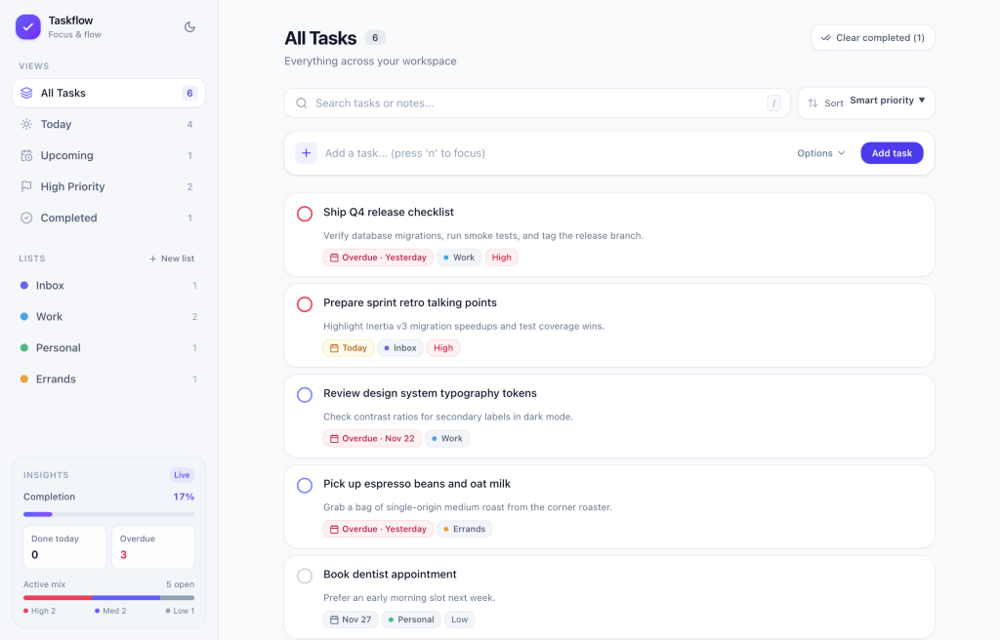
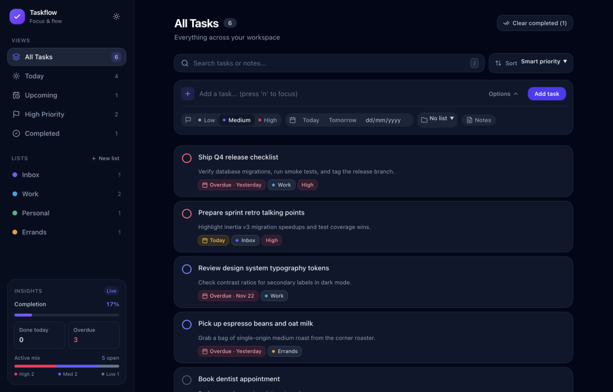
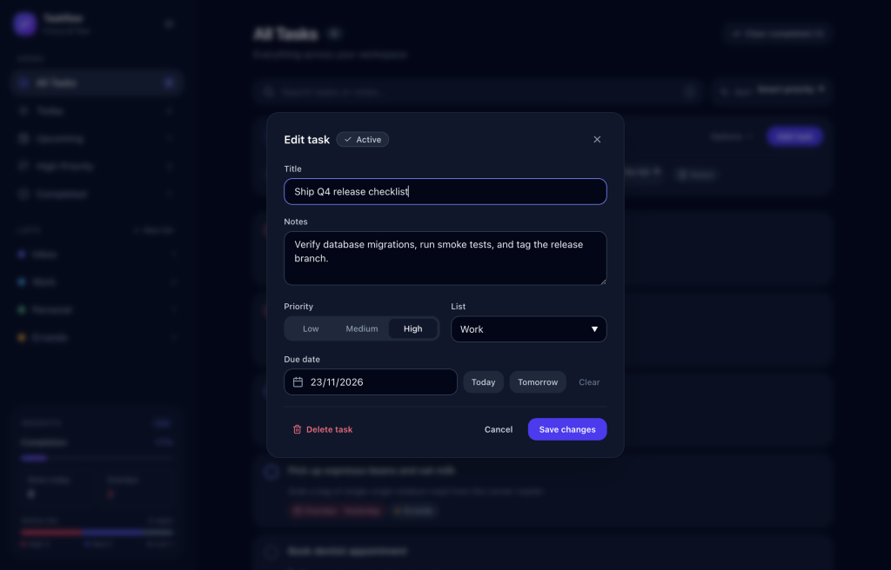

# Taskflow

A modern full-stack Todo application built with **Rust**, **Axum 0.8**, **SQLite (`sqlx`)**, **[`inertia-laravel-rust`](https://github.com/inertiajs/inertia-laravel-rust)** (Inertia v3 protocol), **React 19**, **TypeScript**, and **Tailwind CSS v4**.

## Screenshots

### Light Mode — Workspace, Smart Views & Deferred Insights


### Dark Mode — Expanded Quick-Add Options


### Task Editor Modal


## Features

- **Server-driven SPA via Inertia v3** — Axum routes render React pages directly without a separate REST/GraphQL API or client-side router.
- **SQLite persistence** — Automatic `sqlx` migrations (`migrations/0001_init.sql`) with WAL mode, foreign keys, and fresh relative starter data on first run.
- **Smart views & custom lists** — Filter by `All Tasks`, `Today`, `Upcoming`, `High Priority`, `Completed`, or color-coded custom lists.
- **Partial reloads & deferred props** — Live search and sorting use Inertia partial reloads (`only: ['todos', 'filters']`), while productivity insights load asynchronously via `inertia::defer` and `<Deferred>`.
- **Session flash toasts & validation errors** — `tower-sessions` carries one-time flash notifications (`page.flash`) and field validation errors (`errors`) across Inertia redirects.
- **Modern responsive UI** — Light/dark theme toggle, keyboard shortcuts (`n` to add a task, `/` to search, `Escape` to close modals), priority rings, quick due-date presets, and inline editing.

## Prerequisites

- Rust toolchain (`1.99+` / Edition 2024)
- Node.js (`20+`) and `npm`

## Running in Production Mode

Build the Vite frontend bundle into `public/build`, then start the Axum server:

```bash
npm install
npm run build
cargo run
```

Open [http://127.0.0.1:3000](http://127.0.0.1:3000).

Environment variables:

- `DATABASE_URL` — SQLite connection string (default: `sqlite:todo.db`)
- `PORT` / `BIND_ADDR` — HTTP listen port or full address (default: `127.0.0.1:3000`)

## Running in Development Mode (Vite HMR)

Start the Vite dev server (which writes `public/hot` for Axum's `ViteAssets` helper) and the Rust server in separate terminals:

```bash
npm run dev
```

```bash
cargo run
```

## Verification & Tests

```bash
npm run typecheck
npm run build
cargo test
```
